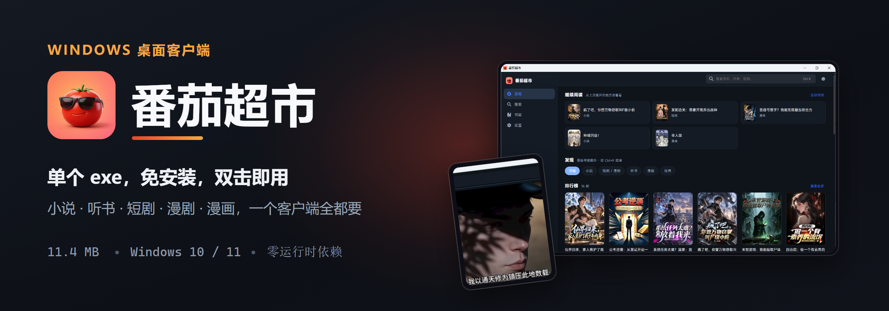
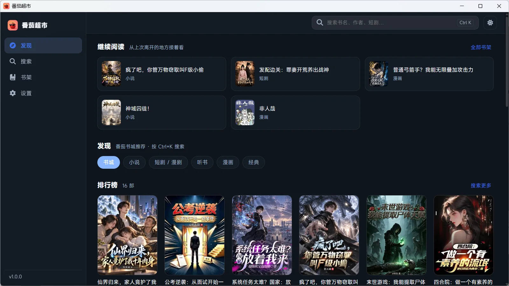
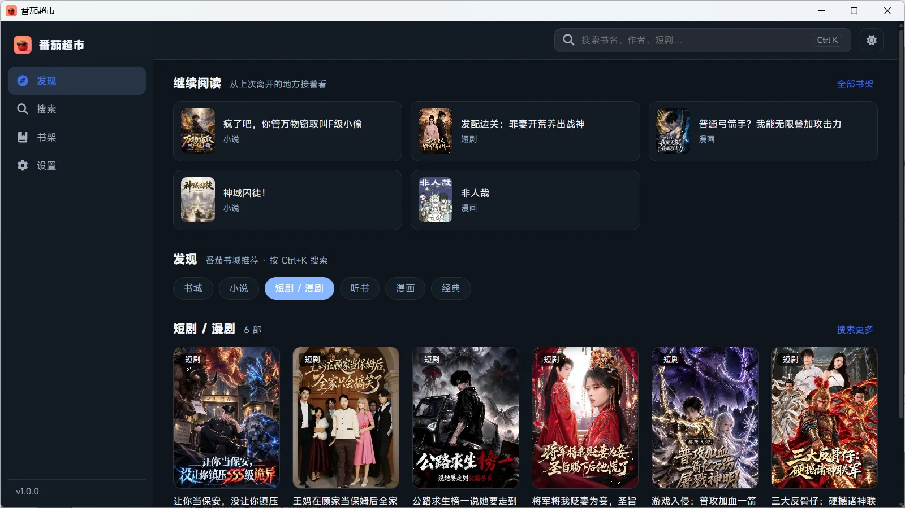
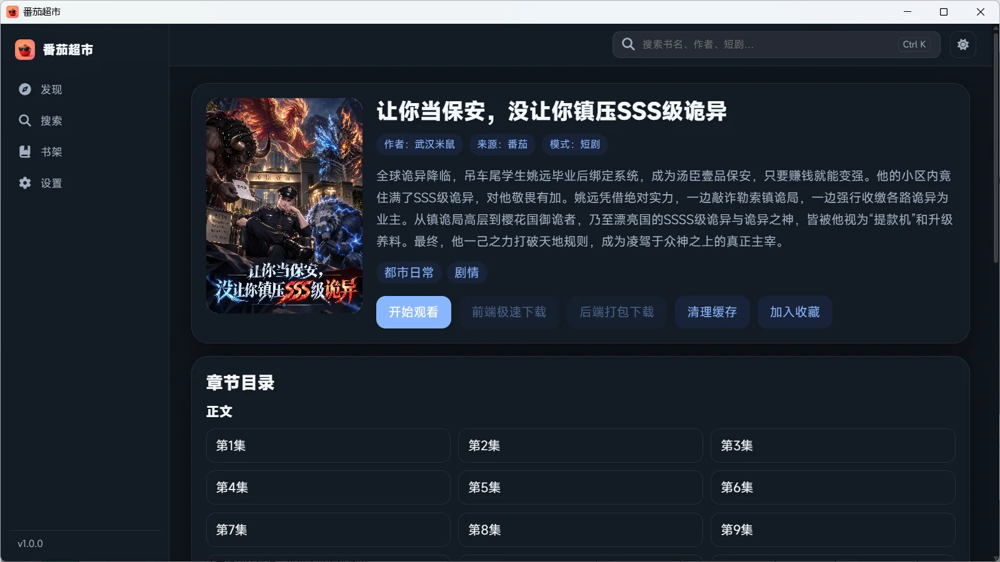
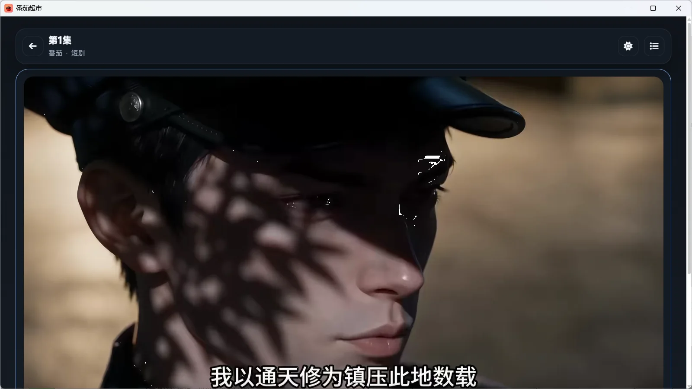
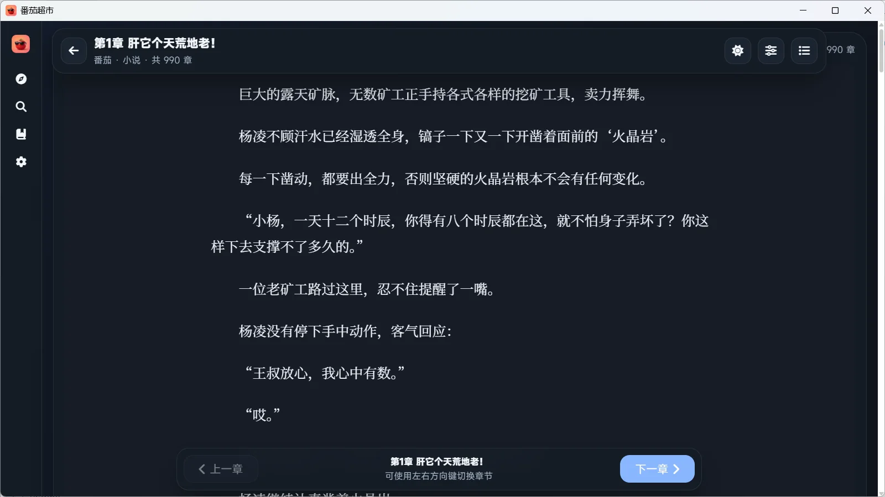
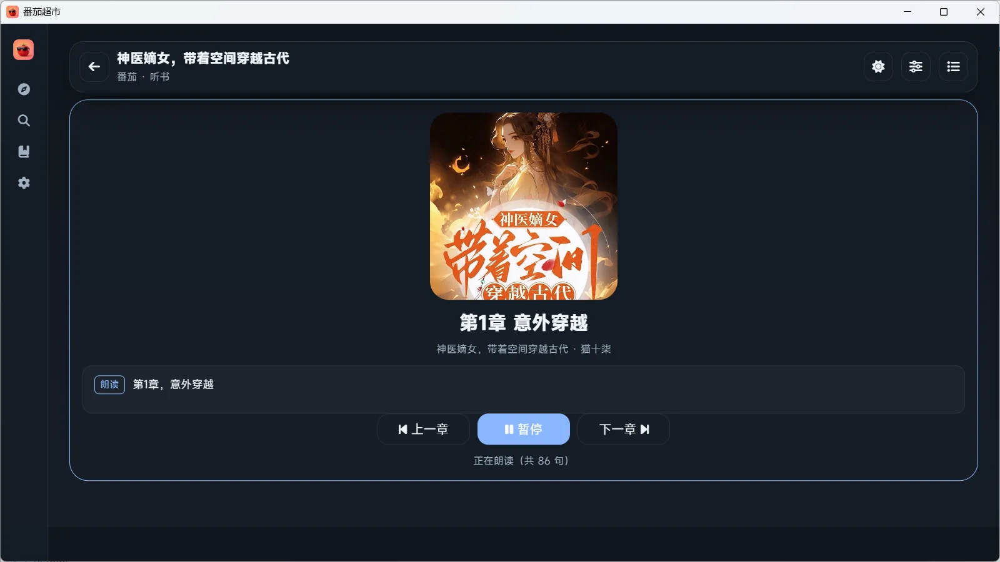
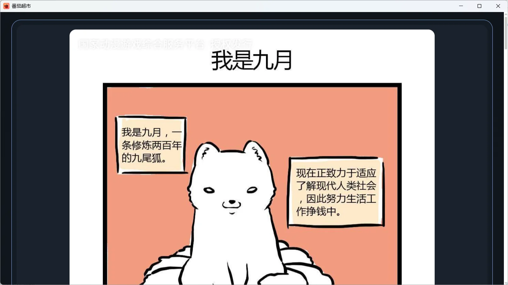
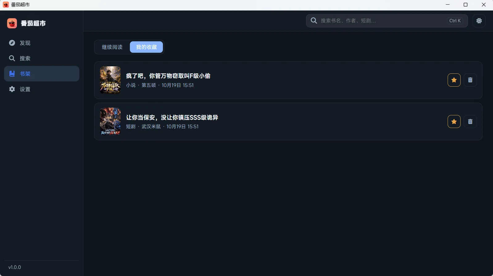
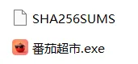

# 番茄超市

<p align="center">
  
</p>

番茄小说的 **Windows 桌面客户端**。单个 exe，双击即用——**小说 · 听书 · 短剧 · 漫剧 · 漫画**，一个客户端全都要。

- **11.4 MB**，零运行时依赖（系统自带 WebView2，不用装任何东西）
- **不安装、不注册、不写注册表**；删掉数据目录就是完全卸载
- 业务核心与 Android 版**同源**：同一个 `fqapi_core`，同一条签名 / 设备池 / CENC 解密 / 选流链路，不是另写一套

---

## 真实界面

下面每一张都是本机实机截图，未经修饰。

<table>
<tr>
<td width="50%" valign="top"><br><sub><b>发现</b>——继续阅读、频道切换、排行榜</sub></td>
<td width="50%" valign="top"><br><sub><b>短剧 / 漫剧</b>——竖屏封面墙，选流后直接播放</sub></td>
</tr>
<tr>
<td width="50%" valign="top"><br><sub><b>详情</b>——简介、标签、开始观看 / 下载、章节目录</sub></td>
<td width="50%" valign="top"><br><sub><b>短剧播放</b>——竖屏沉浸，界面元素默认隐藏</sub></td>
</tr>
<tr>
<td width="50%" valign="top"><br><sub><b>小说阅读</b>——沉浸正文，字号 / 行距 / 主题可调</sub></td>
<td width="50%" valign="top"><br><sub><b>听书</b>——逐句朗读，进度跟随章节</sub></td>
</tr>
<tr>
<td width="50%" valign="top"><br><sub><b>漫画</b>——图片解密后本地提供，按章翻页</sub></td>
<td width="50%" valign="top"><br><sub><b>书架</b>——继续阅读 / 最近浏览 / 收藏，本地保存</sub></td>
</tr>
</table>

<p align="center">
  
  <br><sub>发布产物就这两个文件</sub>
</p>

---

## 能做什么

| 功能 | 说明 |
| --- | --- |
| 发现 | 番茄书城推荐流与排行榜，封面、作者、分类直达 |
| 搜索 | 小说 / 漫画 / 听书 / 短剧四个频道，结果分页与缓存 |
| 详情 | 作品信息、目录分卷展示、前端缓存下载、后端整本打包下载 |
| 小说阅读 | 正文解密渲染、章节跳转、阅读进度 |
| 听书 | 逐句朗读与进度跟随。优先使用上游音频流；拿不到时用系统语音合成朗读脚本 |
| 短剧 / 漫剧 | 选流播放（自动过滤不支持的编码，同画质优先 h264） |
| 漫画 | 图片解密后本地提供，按章翻页 |
| 书架 | 继续阅读 / 最近浏览 / 收藏，本地保存，标题懒加载 |
| 设置 | 主题、正文字号、行距、音量、倍速、自动下一章 |

移动端精简版砍掉的短剧、听书、漫剧，这里都补齐了。

**只有内容消费，没有登录与社交写入**——与 Android 版范围一致：没有追剧、点赞、分享等写操作。

### 桌面端重新设计过，不是手机页面放大

- **常驻侧边栏**：发现 / 搜索 / 书架 / 设置，当前页高亮
- **固定顶栏**：返回、全局搜索、主题切换
- **沉浸阅读**：阅读、听书、短剧、漫画四页收起全部界面元素，鼠标移到窗口顶部才唤出
- **宽屏网格**：卡片按窗口宽度自动增减列数，而不是把内容塞进固定宽度的窄列
- **悬停反馈**：卡片抬升、封面微缩放、清晰的键盘焦点环

| 快捷键 | 作用 |
| --- | --- |
| `Ctrl + K` / `Ctrl + F` | 聚焦搜索框 |
| `Ctrl + L` | 打开书架 |
| `Ctrl + ,` | 打开设置 |
| `Ctrl + D` | 切换浅色 / 深色 |
| `Alt + ←` / `Alt + →` | 后退 / 前进 |
| `S` | 沉浸页（阅读 / 听书 / 短剧 / 漫画）打开设置面板 |
| `F11` | 全屏 |
| `Esc` | 退出全屏，或唤回沉浸页的界面元素 |

---

## 快速开始

### 1. 下载

从 [Releases](https://github.com/vdnight89/tomato-supermarket/releases) 下载 `番茄超市.exe`（v1.0.0）。

### 2. 双击运行

把 exe 复制到任意目录（U 盘、桌面、只读共享都可以），双击即可。**没有安装步骤、没有服务、没有依赖目录。**

首次启动会在 `%LOCALAPPDATA%\fqapp-pc` 建立数据目录，之后所有状态（书架、收藏、阅读进度）都在那里。删掉那个目录就等于完全卸载。

### 3. 校验下载

Release 里同时提供 `SHA256SUMS`：

```powershell
Get-FileHash .\番茄超市.exe -Algorithm SHA256
# 与 SHA256SUMS 里的值一致即未被篡改
```

### 系统要求

| 项 | 要求 |
| --- | --- |
| 操作系统 | Windows 10 21H2 / Windows 11（x64） |
| WebView2 运行时 | 系统自带。Win11 与较新的 Win10 已预装；缺失时安装 [Microsoft Edge WebView2 Runtime](https://developer.microsoft.com/microsoft-edge/webview2/) 即可 |
| 网络 | 需要访问番茄公开接口 |

### 便携模式（可选）

默认数据目录在 `%LOCALAPPDATA%`，这样 exe 本身永远只有一个文件。想做成纯 U 盘绿色版：

```powershell
$env:FQPC_HOME = "E:\fqapp-data"
.\番茄超市.exe
```

`FQPC_HOME` 指向的目录会成为唯一的数据落点（含设备池、漫画图片缓存、日志）。

---

## 它是怎么跑起来的

```
番茄超市.exe  (单个文件)
├── desktop/        Tauri v2 外壳：窗口、单实例、资源内嵌、loopback 启动
├── core/           fqapi_core：与 Android 版完全一致的 Rust 核心
├── ui/             Web UI：发现 / 搜索 / 详情 / 阅读 / 听书 / 短剧 / 漫画 / 书架 / 设置
└── runtime/        默认配置与响应过滤器（编译进 exe，首次启动释放）
```

启动流程：

1. 外壳把内嵌的 Web UI 与默认配置写进数据目录。UI 每次覆盖（保证升级生效），配置文件只在缺失时创建，不会覆盖用户改动。
2. 启动 Rust 核心，加载配置、设备池与过滤器，监听 loopback 端口。
3. 窗口直接打开 `http://127.0.0.1:<端口>/_session/<一次性能力>`；适配器把它换成 HttpOnly 会话 Cookie 后重定向到 `/`。

浏览器上下文与 API **同源**，因此不需要任何 CORS 例外，页面也永远拿不到会话能力串。loopback 保留了 Host / Origin 校验与会话校验。

### 为什么端口要固定

Web UI 的 origin 是 `http://127.0.0.1:<端口>`。端口一变，浏览器就当作一个全新站点，localStorage 里的书架、收藏、阅读位置全部作废。因此外壳优先使用 `config.json` 的 `port`（8080），被占用时顺延 8 个端口，全都占用才退让给系统随机端口——这时会在日志里明确告警。

---

## 从源码构建

需要 Rust stable（已在 1.99.0 上验证）。Node、Tauri CLI 都不需要。

```powershell
cargo build --release -p fqpc
# 产物: target\release\fqpc.exe
```

或者用封装脚本，它会顺便产出校验和：

```powershell
.\tools\build.ps1
# 产物: dist\番茄超市.exe + dist\SHA256SUMS
```

> 改过 `ui/` 下的文件后必须重新 `cargo build`——UI 是**编译期内嵌**进 exe 的，不是运行时从磁盘读取。

### 校验

```powershell
cargo test --offline -p fqapi_core   # 核心协议与回归测试
.\tools\check-format.ps1              # rustfmt 覆盖检查
```

`fqapi_core` 当前 **161 项通过**。另有 6 项用例需要 Windows 开发者模式（创建符号链接需 `SeCreateSymbolicLinkPrivilege`），未开启时以 `os error 1314` 失败——这是环境限制，不是回归。

---

## 已知限制

- **仅 Windows x64。** 外壳用了 Tauri v2 + WebView2，跨平台需要另行适配。
- **设备池明文存储。** Android 版用 Keystore 里的密钥加密设备池，PC 版没有接入 DPAPI，核心会在日志里提示 `saving device pool unencrypted`。设备身份存放在 `%LOCALAPPDATA%\fqapp-pc\config\device_pool.json`，属于本机用户数据。
- **听书目前走语音合成。** 上游的音频播放接口会返回 `invalid aid`，拿不到音频流；听书改为用系统语音合成朗读上游提供的带时间戳脚本，效果与安卓端的系统 TTS 一致，但音色取决于系统里安装的中文语音包。
- **部分推荐频道上游可能返回空。** 书城、听书、看剧、漫画频道内容稳定；小说与经典频道是否可用取决于番茄当前的 `tab_type` 配置，页面会提示「这个频道暂时没有内容」而不是转圈。
- **仅内容消费，不提供登录与社交写入。** 与 Android 版范围一致。

---

## 许可

沿用上游仓库的 `LICENSE`。
